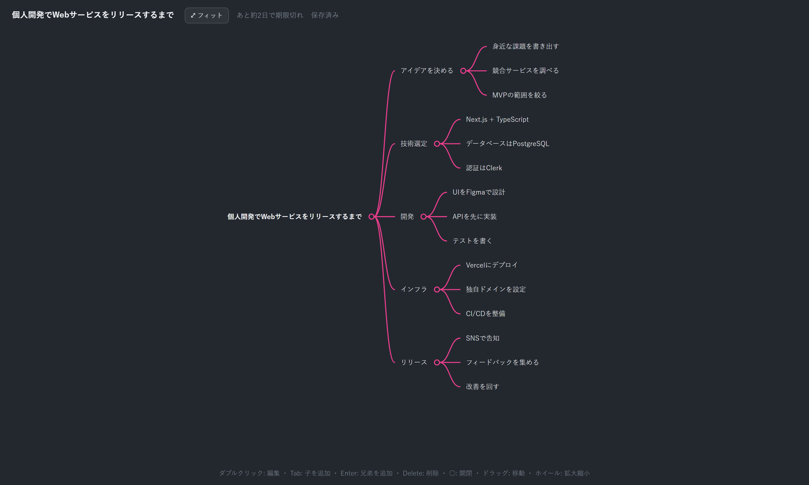

# mindmap-mcp

**AIが樹形図（マインドマップ）を作れるMCPサーバ。** ダーク背景・ピンクの曲線コネクタのデザインで、
生成した図は **3日間だけ有効なURL** で公開され、そのURL上で **直接編集** できます。

<p align="center">
  
</p>

<p align="center"><i>AIに「〜を樹形図にして」と頼むと、このエディタのURLが返ってきます。</i></p>

---

## ✨ 特長

| | |
|---|---|
| 🌳 **AIが樹形図を生成** | MCPツール `create_mindmap` にツリー構造を渡すだけ |
| 🎨 **こだわりのダークデザイン** | ピンクの曲線コネクタ・○開閉トグル・青い選択枠 |
| 🔗 **3日間有効の共有URL** | 発行されたURLをそのまま共有・編集。3日後に自動失効＆削除 |
| ✏️ **ブラウザでそのまま編集** | 追加・編集・削除・開閉、パン/ズーム、**自動保存** |
| 🎬 **なめらかなアニメーション** | 開閉・追加時にノードとコネクタが同期して動く |
| 🖥️ **フィット表示** | ワンクリック（`F`キー）で全体を画面に収める |
| 📦 **依存ゼロ** | `npm install` 不要。Node.js の標準機能だけで動作（Node 18+） |
| 🌐 **HTTP専用のMCP** | Streamable HTTP トランスポート。常駐1プロセスで完結 |

---

## 🚀 クイックスタート

```bash
git clone https://github.com/sekiguchimend/mod_mcp.git
cd mod_mcp
node server.js
```

起動すると以下が同じプロセスで立ち上がります。

- **MCPエンドポイント**: `http://localhost:4387/mcp`
- **編集画面**: `http://localhost:4387/e/<token>`

> 3日URLはこのサーバが起動している間だけ有効です。常駐させるなら `pm2 start server.js --name mindmap-mcp` などでデーモン化してください。

### MCPクライアントへの登録（HTTPトランスポート）

Claude Code:

```bash
claude mcp add --transport http mindmap http://localhost:4387/mcp
```

Claude Desktop など（設定ファイル）:

```json
{
  "mcpServers": {
    "mindmap": {
      "type": "http",
      "url": "http://localhost:4387/mcp"
    }
  }
}
```

> CORS許可済みなので、ブラウザ系MCPクライアントからも `/mcp` に接続できます。

---

## 🛠️ ツール

### `create_mindmap`

樹形図を作成し、編集可能なURL（3日有効）を返します。

```jsonc
{
  "title": "EC2構成の検証環境を構築",
  "root": {
    "text": "EC2構成の検証環境を構築",
    "children": [
      "最初に手応えを感じたタスク",
      { "text": "CircleCIによるCI/CDパイプラインも整備" },
      { "text": "横展開", "children": ["他プロダクトの構成を流用"] }
    ]
  }
}
```

- ノードは `{ text, children? }` のネスト。文字列を直接書いてもOK。
- `root` の代わりに `tree`（トップレベル枝の配列）でも可。
- 返り値（`structuredContent`）: `{ url, token, expiresAt, expiresAtISO }`

### `get_mindmap_url`

既存トークンのURLと残り有効時間を返します（期限切れなら無効と報告）。

---

## 🖱️ 編集画面の操作

<p align="center">
  
</p>

| 操作 | 内容 |
|---|---|
| ダブルクリック | ノードのテキストを編集 |
| `Tab` | 選択ノードに **子** を追加 |
| `Enter` | 選択ノードに **兄弟** を追加 |
| `Delete` / `Backspace` | 選択ノードを削除（ルート以外） |
| `F` / フィットボタン | 全体を画面に合わせる |
| ○（ピンクの丸） | 枝の開閉 |
| ＋ボタン | 子ノードを追加 |
| 背景ドラッグ | 画面移動（パン） |
| ホイール | 拡大 / 縮小 |

編集内容・表示位置は **自動保存** されます（保存しても有効期限は延長されません）。

---

## ⚙️ 環境変数

| 変数 | 既定値 | 説明 |
|---|---|---|
| `MINDMAP_PORT` | `4387` | HTTPサーバのポート |
| `MINDMAP_BASE_URL` | `http://localhost:<PORT>` | 返すURLのベース。外部公開時はここを公開ドメインに |
| `MINDMAP_DATA_DIR` | `./data` | 図の保存先 |

---

## 🧩 仕組み

```
AI ──(create_mindmap)──▶  mindmap-mcp サーバ  ──▶  3日有効のURLを返す
                              │  POST /mcp (MCP)
                              │  GET  /e/<token> (編集画面)
                              ▼
                          data/<token>.json  ──(3日経過)──▶  自動削除・404
```

1. MCPツール `create_mindmap` を呼ぶと、図が `data/` に保存されURLが返ります。
2. 同じサーバがそのURLで編集画面（ダーク＋ピンクのデザイン）を配信します。
3. `createdAt + 3日` を過ぎたURLは **404** になり、ファイルは自動削除されます。

---

## 📄 ライセンス

MIT
